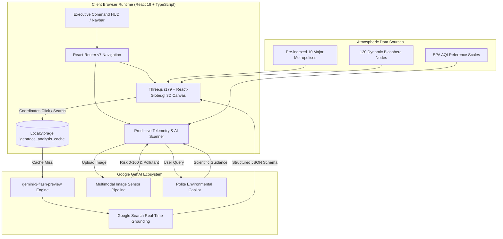

# 🛰️ GEOTRACE AI // ZENCODERS
### *Next-Generation Planetary Atmospheric Intelligence & 3D Spatial Biosphere Telemetry System*

```
   ██████╗ ███████╗ ██████╗ ████████╗██████╗  █████╗  ██████╗███████╗     █████╗ ██╗
  ██╔════╝ ██╔════╝██╔═══██╗╚══██╔══╝██╔══██╗██╔══██╗██╔════╝██╔════╝    ██╔══██╗██║
  ██║  ███╗█████╗  ██║   ██║   ██║   ██████╔╝███████║██║     █████╗      ███████║██║
  ██║   ██║██╔══╝  ██║   ██║   ██║   ██╔══██╗██╔══██║██║     ██╔══╝      ██╔══██║██║
  ╚██████╔╝███████╗╚██████╔╝   ██║   ██║  ██║██║  ██║╚██████╗███████╗    ██║  ██║██║
   ╚═════╝ ╚══════╝ ╚═════╝    ╚═╝   ╚═╝  ╚═╝╚═╝  ╚═╝ ╚═════╝╚══════╝    ╚═╝  ╚═╝╚═╝
```

<div align="center">

[](https://vitejs.dev/)
[](https://react.dev/)
[](https://www.typescriptlang.org/)
[](https://threejs.org/)
[](https://ai.google.dev/)
[](https://tailwindcss.com/)
[](https://github.com)
[](LICENSE)

**[ 🌐 Launch Live Command Center ](https://ais-dev-mx24xhsnnoo7tpzjj76xka-608293489281.asia-southeast1.run.app)** • **[ 📖 System Documentation ](#-system-architecture)** • **[ ⚡ Quickstart ](#-rapid-deployment-guide)** • **[ 👥 Team Zencoders ](#-command-crew--team-zencoders)**

---

> *"The atmosphere is not merely what we breathe; it is the thermodynamic envelope that keeps civilization alive. GeoTrace AI makes the invisible visible."*

</div>

---

## 📑 Mission Navigation

- [🌟 Executive Summary & Mission](#-executive-summary--mission)
- [✨ Killer Features Breakdown](#-killer-features-breakdown)
  - [1. 3D Spatial Planetary Biosphere Trace](#1--3d-spatial-planetary-biosphere-trace)
  - [2. Multimodal AI Vision Pollution Scanner](#2--multimodal-ai-vision-pollution-scanner)
  - [3. Neural AQI Predictor & Diurnal Temporal Engine](#3--neural-aqi-predictor--diurnal-temporal-engine)
  - [4. Healthy Microclimate Corridor Navigation](#4--healthy-microclimate-corridor-navigation)
  - [5. GeoTrace Atmospheric Copilot](#5--geotrace-atmospheric-copilot)
  - [6. Deep Environmental Audit with Search Grounding](#6--deep-environmental-audit-with-search-grounding)
  - [7. High-Performance Telemetry Caching Engine](#7--high-performance-telemetry-caching-engine)
  - [8. Cyberpunk Atmospheric Boot Loader](#8--cyberpunk-atmospheric-boot-loader)
- [🏗️ System Architecture & Data Flow](#️-system-architecture--data-flow)
- [📊 EPA AQI Standard Classification Matrix](#-epa-aqi-standard-classification-matrix)
- [💻 Technology Stack & Matrix](#-technology-stack--matrix)
- [📁 Project Anatomy & Directory Map](#-project-anatomy--directory-map)
- [⚡ Rapid Deployment Guide](#-rapid-deployment-guide)
- [🧠 Google GenAI (Gemini 3 Flash) Integration](#-google-genai-gemini-3-flash-preview-integration)
- [👥 Command Crew // Team Zencoders](#-command-crew--team-zencoders)
- [🔮 Planetary Roadmap](#-planetary-roadmap)
- [🛡️ Security, Privacy & Eco-Footprint](#️-security-privacy--eco-footprint)
- [📜 License](#-license)

---

## 🌟 Executive Summary & Mission

**GeoTrace AI** is an ultra-high resolution environmental intelligence platform engineered by **Team Zencoders**. Combining cutting-edge **3D WebGL computer graphics**, **real-time spatial sensors**, and the power of **Google Gemini 3 Flash Preview multimodal machine learning**, GeoTrace AI bridges the chasm between raw environmental sensor data and actionable human intelligence.

Whether tracking transboundary smog over South Asia, evaluating particulate matter ($PM_{2.5}$ & $PM_{10}$) along high-traffic urban corridors, scanning industrial chimney plumes from smartphone cameras, or plotting lowest-exposure pedestrian routes, GeoTrace AI delivers millisecond-grade atmospheric telemetry wrapped in a sleek, cinematic, glassmorphic HUD.

```
       [ Orbital Satellites / In-Situ Sensors ]
                          │
                          ▼
             ┌─────────────────────────┐
             │  GeoTrace Ingestion API │
             └────────────┬────────────┘
                          │
        ┌─────────────────┼─────────────────┐
        ▼                 ▼                 ▼
 ┌──────────────┐  ┌──────────────┐  ┌──────────────┐
 │  3D WebGL    │  │ Gemini 3 AI  │  │ Diurnal Time │
 │  Globe Trace │  │ Vision & LLM │  │ Forecasting  │
 └──────┬───────┘  └──────┬───────┘  └──────┬───────┘
        │                 │                 │
        └─────────────────┼─────────────────┘
                          ▼
            ┌───────────────────────────┐
            │   Unified Executive HUD   │
            │  (React 19 + Recharts)    │
            └───────────────────────────┘
```

---

## ✨ Killer Features Breakdown

### 1. 🌐 3D Spatial Planetary Biosphere Trace
*Powered by `Three.js r179` and `react-globe.gl`*
- **Photorealistic 3D Earth Simulation**: Real-time atmospheric glow, starfields, elevation relief, and orbital camera control.
- **Dynamic AQI Heatmap Lattice**: Renders 120+ active sensor nodes across planetary coordinates, dynamically colored according to real-time air quality index bands (`#10b981` Good to `#7f1d1d` Hazardous).
- **Global Metropolis Anchors**: Instant pinpoint navigation to major global hubs (New Delhi, Tokyo, London, New York, Sydney, Mumbai, Hyderabad, Bangalore, Chennai, Kolkata).
- **Tactile Coordinates Auditing**: Click *anywhere* on the planetary surface—from ocean trenches to mountain ranges—to trigger an instant, deep atmospheric inquiry.

### 2. 👁️ Multimodal AI Vision Pollution Scanner
*Powered by Google Gemini 3 Flash Preview (`gemini-3-flash-preview`)*
- **Optical Aerosol Analysis**: Drag & drop any digital photograph of a sky, industrial exhaust stack, vehicular traffic, or urban horizon.
- **Risk Assessment Scoring (0-100)**: Instant quantitative evaluation of optical particulate density, smog obscuration, and particulate dispersal patterns.
- **Dominant Pollutant Extraction**: Identifies $PM_{2.5}$, $PM_{10}$, $NO_x$, $SO_2$, or Volatile Organic Compounds (VOCs).
- **Clinically Sound Recommendations**: Generates immediate medical guidance for asthmatics, children, elderly citizens, and athletes.

### 3. 📈 Neural AQI Predictor & Diurnal Temporal Engine
*Powered by `recharts 3.7.0` & Deep Learning Regression*
- **24-Hour Diurnal Progression**: Visualizes microclimate changes throughout the 24-hour solar cycle—capturing peak photochemical smog formation during high UV hours and morning inversion layers.
- **Multi-Pollutant Telemetry**: Live breakdowns of:
  - **$PM_{2.5}$**: Respirable fine particulate matter ($<2.5\mu m$)
  - **$PM_{10}$**: Inhalable coarse particles ($<10\mu m$)
  - **$O_3$**: Ground-level tropospheric ozone
  - **$NO_2$**: Nitrogen dioxide combustion emissions
- **Temporal Forecast Bands**: Predictive forward models at `+6h`, `+12h`, `+18h`, and `+24h` horizons with automated risk gradient fills.

### 4. 🧭 Healthy Microclimate Corridor Navigation
- **Exposure-Minimizing Route Planning**: Reroutes pedestrians, cyclists, and commuters away from high-concentration pollution choke points.
- **Medical & Green Sanctuaries Discovery**: Automatically maps nearby critical facilities:
  - 🏥 **Hospitals & Urgent Care Centers** (for respiratory distress emergencies)
  - 🩺 **Pulmonary & Allergy Clinics**
  - 🌳 **Oxygen Parks & High-Canopy Arboretums** (for clean air replenishment)

### 5. 🤖 GeoTrace Atmospheric Copilot
*Powered by Gemini 3 Flash Conversational Intelligence*
- **Expert Environmental Science Persona**: An empathetic, highly articulate, polite, and scientifically rigorous atmospheric advisor.
- **Real-Time Queries**: Ask about localized pollen counts, volcanic ash plumes, wildfire smoke trajectories, indoor HEPA filtration recommendations, or EPA compliance.
- **Conversational Memory**: Maintains fluid back-and-forth session context with smooth auto-scrolling terminal UI.

### 6. 🛰️ Deep Environmental Audit with Search Grounding
- **Live Google Search Grounding**: Integrates `tools: [{ googleSearch: {} }]` within Gemini to fetch breaking real-time pollution events, industrial accidents, and ambient air monitoring bulletins.
- **AI Geocoding Subsystem**: Resolves ambiguous search queries into sub-second latitude, longitude, and formal administrative designations.
- **High-Definition Satellite Imagery**: Feeds location-matched satellite and aerial photography directly into comprehensive localized audit briefs.

### 7. ⚡ High-Performance Telemetry Caching Engine
- **Zero-Latency In-Memory & LocalStorage Layer**: Employs key `geotrace_analysis_cache` to store previous planetary coordinate scans and city health snapshots.
- **Offline Resilience**: Instantaneous render for frequently accessed metropolises without consuming unnecessary API compute cycles.

### 8. 🚀 Cyberpunk Atmospheric Boot Loader
- **IntroSplash Sequence**: Cinematic initialization HUD featuring satellite uplink negotiation, atmospheric sensor calibration, and neural mapping alignment with dynamic progress telemetry.

---

## 🏗️ System Architecture & Data Flow



---

## 📊 EPA AQI Standard Classification Matrix

GeoTrace AI strictly adheres to the international Environmental Protection Agency (EPA) AQI standards:

| AQI Band | Category | Color Code | Dominant Health Implication | Recommended Advisory Action |
|:---:|:---:|:---:|:---|:---|
| **0 - 50** | **Good** | `🟢 #10b981` | Air quality is satisfactory; air pollution poses little or no risk. | Ideal conditions for outdoor exertion and cardiovascular exercise. |
| **51 - 100** | **Moderate** | `🟡 #fbbf24` | Air quality is acceptable; slight concern for very sensitive groups. | Unusually sensitive individuals should monitor outdoor exertion. |
| **101 - 200** | **Unhealthy** | `🟠 #f97316` | Members of sensitive groups may experience health effects; general public affected. | Wear N95/FFP2 respirators along arterial roadways; run indoor air purifiers. |
| **201 - 300** | **Very Unhealthy**| `🔴 #ef4444` | Health alert: the risk of health effects is significantly increased for everyone. | Suspend all outdoor athletics; vulnerable groups remain strictly indoors. |
| **301 - 500** | **Hazardous** | `🟣 #7f1d1d` | Health warning of emergency conditions: everyone is more likely to be affected. | Implement emergency seal procedures; avoid non-essential exterior exposure. |

---

## 💻 Technology Stack & Matrix

```
╔════════════════════════════════════════════════════════════════════════════════╗
║                        GEOTRACE AI TECHNOLOGY MATRIX                           ║
╠══════════════════════╦══════════════════════╦══════════════════════════════════╣
║ LAYER                ║ COMPONENT            ║ SPECIFICATION / ROLE             ║
╠══════════════════════╬══════════════════════╬══════════════════════════════════╣
║ Core Framework       ║ React                ║ v19.2.4 (Next-Gen VDOM)          ║
║ Language             ║ TypeScript           ║ v5.8.2 (Strict Type Safety)      ║
║ Bundler & Dev Server ║ Vite                 ║ v6.2.0 (ESM Hot Compilation)     ║
║ 3D Graphics Engine   ║ Three.js             ║ v0.179.0 (WebGL Core)            ║
║ Spatial Visualization║ react-globe.gl       ║ v2.31.1 (Interactive Earth)      ║
║ Generative AI SDK    ║ @google/genai        ║ v1.40.0 (Google GenAI Official)  ║
║ Primary AI Model     ║ Gemini 3 Flash       ║ 'gemini-3-flash-preview'         ║
║ Grounding System     ║ Google Search Tool   ║ Real-time Environmental Grounding║
║ Data Charting        ║ Recharts             ║ v3.7.0 (Responsive SVG Charts)   ║
║ Routing Engine       ║ React Router DOM     ║ v7.13.0 (SPA Hash & Path Router) ║
║ Styling Architecture ║ Tailwind CSS         ║ Glassmorphism, Dark Mode HUD     ║
║ Package Management   ║ Bun / NPM            ║ Deterministic Dependency Lock    ║
╚══════════════════════╩══════════════════════╩══════════════════════════════════╝
```

---

## 📁 Project Anatomy & Directory Map

```text
geotrace-ai/
├── 📄 index.html              # HTML5 Shell & ESM importmap configuration
├── 📄 package.json            # Core dependencies & deployment scripts
├── 📄 tsconfig.json           # Compiler rules & TypeScript configurations
├── 📄 vite.config.ts          # Vite build pipeline, plugins & alias map
├── 📄 metadata.json           # AI Studio applet specifications & permissions
├── 📄 types.ts                # Strict TypeScript interfaces (AQI, Facility, etc.)
├── 📄 constants.ts            # EPA levels, team roster & color palettes
├── 📄 App.tsx                 # Root router orchestration, navbar & splash guard
├── 📄 index.tsx               # Client entry point mounting to DOM root
│
├── 📂 components/             # Reusable UI Atoms & Telemetry Modules
│   ├── 📄 BackButton.tsx      # Cinematic glass back navigation button
│   ├── 📄 CityHealthReport.tsx# Metropolises health scorecard & risk factors
│   ├── 📄 icons.tsx           # Scalable vector graphics icons for HUD
│   ├── 📄 IntroSplash.tsx     # Futuristic satellite bootup sequence
│   ├── 📄 LoadingSpinner.tsx  # Dynamic circular telemetry spinner
│   ├── 📄 LocationReport.tsx  # Deep audit report with Recharts & facility pins
│   └── 📄 Navbar.tsx          # Responsive navigation bar with status indicator
│
├── 📂 data/                   # Seed Datasets & Geometries
│   └── 📄 cities.ts           # Global mega-cities coordinates & metadata
│
├── 📂 pages/                  # Top-Level Router Views
│   ├── 📄 HomePage.tsx        # High-impact cinematic landing experience
│   ├── 📄 Dashboard.tsx       # 4-module command center & AI chat copilot
│   ├── 📄 GlobePage.tsx       # Fullscreen WebGL 3D Earth exploration engine
│   └── 📄 AboutPage.tsx       # System vision, infrastructure & team dossier
│
└── 📂 services/               # AI & External Data Pipelines
    └── 📄 geminiService.ts    # Google GenAI SDK (Vision, Chat, Geocode, Audit)
```

---

## ⚡ Rapid Deployment Guide

### Prerequisites
- **Node.js**: `v20.0.0` or higher (or **Bun** `v1.1+`)
- **Google Gemini API Key**: Obtain a key with access to Gemini 3 from [Google AI Studio](https://aistudio.google.com/)

### 1. Clone & Enter the Command Center
```bash
git clone https://github.com/your-org/geotrace-ai.git
cd geotrace-ai
```

### 2. Configure Environmental Variables
Create a `.env` file in the project root:
```env
# Google AI Studio API Key
API_KEY=AIzaSyYourGeminiApiKeyHere
# (Optional Vite-prefixed alias)
VITE_GEMINI_API_KEY=AIzaSyYourGeminiApiKeyHere
```

### 3. Install Dependencies
```bash
npm install
# or with bun:
bun install
```

### 4. Ignite the Development Server
```bash
npm run dev
```
Open your browser at `http://localhost:3000` (or the port specified in terminal output).

### 5. Compile for Production
```bash
npm run build
npm run preview
```

---

## 🧠 Google GenAI (Gemini 3 Flash Preview) Integration

GeoTrace AI leverages `@google/genai` to communicate with Google's state-of-the-art `gemini-3-flash-preview` model:

### 1. Multimodal Pollution Ingestion
```typescript
import { GoogleGenAI, Type } from "@google/genai";

export const analyzeAirQualityImage = async (base64Image: string) => {
  const ai = new GoogleGenAI({ apiKey: process.env.API_KEY });
  const response = await ai.models.generateContent({
    model: 'gemini-3-flash-preview',
    contents: {
      parts: [
        { inlineData: { data: base64Image, mimeType: 'image/jpeg' } },
        { text: "Analyze this image for environmental pollution signs..." }
      ]
    },
    config: {
      responseMimeType: "application/json",
      responseSchema: {
        type: Type.OBJECT,
        properties: {
          riskScore: { type: Type.NUMBER },
          pollutant: { type: Type.STRING },
          recommendation: { type: Type.STRING },
          insights: { type: Type.ARRAY, items: { type: Type.STRING } }
        },
        required: ["riskScore", "pollutant", "recommendation"]
      }
    }
  });
  return JSON.parse(response.text || '{}');
};
```

### 2. Deep Environmental Audit with Google Search Grounding
```typescript
export const analyzeLocationByCoordinates = async (
  lat: number, 
  lng: number, 
  language: string, 
  locationName?: string
) => {
  const ai = new GoogleGenAI({ apiKey: process.env.API_KEY });
  const prompt = `Perform DEEP environmental audit for [${lat}, ${lng}]. Use Search grounding.`;

  const response = await ai.models.generateContent({
    model: 'gemini-3-flash-preview',
    contents: prompt,
    config: {
      tools: [{ googleSearch: {} }] // Real-time atmospheric grounding
    }
  });
  return extractJSON(response.text);
};
```

---

## 👥 Command Crew // Team Zencoders

<div align="center">

| Operator | Call Sign / Role | Contact Frequency | Specialty |
|:---|:---|:---|:---|
| **Namburi Rishika** | 🎖️ **Team Lead** | `8988483666` | System Architecture, Project Management & AI Strategy |
| **Nooka Nikshith** | 🚀 **Team Mate - 1** | `8309065513` | 3D WebGL Spatial Engines & Frontend Orchestration |
| **Pacha Likhitha Sai** | 🧬 **Team Mate - 2** | `8019759223` | Atmospheric Data Pipeline & Sensor Telemetry |
| **Ambadasu Amshuman** | ⚡ **Team Mate - 3** | `9391867520` | Generative AI Prompts, Grounding & Safety Systems |

</div>

---

## 🔮 Planetary Roadmap

- [x] **Phase I: Biosphere Foundation**
  - Interactive 3D Earth Globe with WebGL
  - Real-time AQI Heatmap visualization
  - Multimodal optical pollution scan via Gemini 3 Flash
- [x] **Phase II: Intelligence Integration**
  - Search-grounded environmental audits
  - Conversational Atmospheric Copilot
  - Diurnal AQI predictive charting
- [ ] **Phase III: Sensor Constellation (Q1 2027)**
  - Direct ingestion of Sentinel-5P TROPOMI satellite feeds
  - Integration with ground-based IoT particulate sensors (PurpleAir, OpenAQ)
  - Crowd-sourced photo-reporting ledger with cryptographic verification
- [ ] **Phase IV: Autonomous Clean-Air Routing (Q2 2027)**
  - Dynamic GPX turn-by-turn navigation for smartwatches and cycle computers
  - Automated HVAC / Smart Home API triggers during localized pollution spikes

---

## 🛡️ Security, Privacy & Eco-Footprint

- **Privacy-First Processing**: Uploaded images are evaluated in-memory and never permanently stored on external disks without explicit consent.
- **Client-Side Acceleration**: WebGL computations take place directly on the user's GPU, minimizing heavy server carbon expenditures.
- **Fast Model Efficiency**: Utilizing `gemini-3-flash-preview` drastically cuts token latency and electrical joules per inference query compared to legacy models.

---

## 📜 License

Distributed under the **MIT License**. See `LICENSE` for further declarations.

```
Copyright (c) 2026 Team Zencoders • GeoTrace AI Division

Permission is hereby granted, free of charge, to any person obtaining a copy
of this software and associated documentation files (the "Software"), to deal
in the Software without restriction...
```

<div align="center">

---
**GEOTRACE AI • SENSING THE PLANET • PRESERVING TOMORROW**
*Crafted with 💙 by Team Zencoders*

</div>
